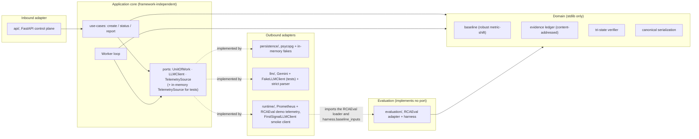
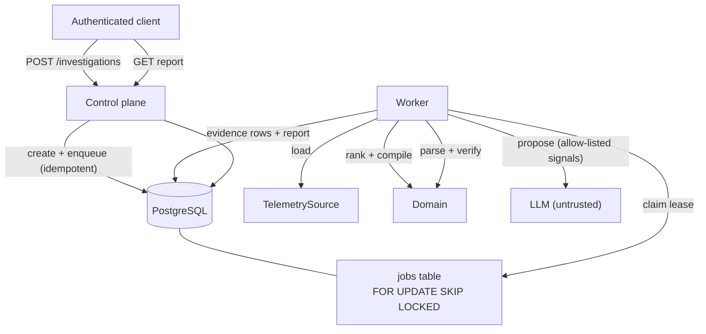

# Architecture Overview

## Status

Implemented through Phase 9 plus ADRs 0017 to 0019: the deterministic domain, PostgreSQL
persistence with a `SKIP LOCKED` job queue, the async LLM provider boundary, the FastAPI
control plane and worker, the label-safe RCAEval RE2 evaluation harness, dependency-free
Prometheus metrics at `/metrics` (Phase 8), the `python -m incident_evidence_compiler`
entrypoint and container image (Phase 9), Prometheus telemetry ingestion (ADR 0017), and the
`baseline_ranking` report field (ADR 0019). What the code does not yet do is listed under
Known gaps in `README.md`.

## Layers and dependency inversion

The domain is standard-library only and knows nothing about frameworks or infrastructure.
Everything else depends inward through ports (protocols); adapters implement them.

`runtime/` is also the composition root: `runtime/server.py` is the only module that constructs
concrete infrastructure, and the client it serves for `IEC_LLM_PROVIDER=fake` (the default) is
the labelled smoke client `FirstSignalLLMClient`, not the test fake. Both served telemetry
sources also import `evaluation.harness.baseline_inputs` (`ScaleFloorPolicy`,
`to_baseline_inputs`; `runtime/prometheus.py:27`, used at `:258` and `:284`, and
`runtime/telemetry.py:24`), so the served path depends on the evaluation package;
`PROJECT_CONTEXT.md` lists removing that import as deferred.

## Data and job flow

## Trust boundaries

- Identity establishes tenant context; request bodies cannot choose it. Every data query is
  tenant-scoped, and a cross-tenant read returns `404`, never `403`.
- PostgreSQL is the durable source of truth; only application-owned parameterized queries
  reach it (via `psycopg`).
- Telemetry is untrusted evidence, loaded through a bounded adapter.
- Gemini output is an untrusted proposal, constrained to an allow-listed signal set and a
  strict, message-free parser, then decided by the deterministic verifier.
- A report is accepted only after local evidence and policy validation; error surfaces carry
  only stable codes, never model text or tenant data.
- Evaluation ground-truth labels live in an evaluation-only sidecar and never reach any
  committed artifact. One served path holds them anyway: the demo `RcaevalTelemetrySource`
  keeps each case's `<service>_<fault>` directory locator in memory for an operator-only
  `locator_for` lookup (`runtime/telemetry.py:60, 71, 80-86`). The worker, the prompt and
  reports see only the opaque `case-<digest>` id (`runtime/telemetry.py:32-40, 70`).

## Delivery semantics

The worker queue is PostgreSQL-backed with leases and `SELECT … FOR UPDATE SKIP LOCKED`.
Delivery is at least once; a per-attempt deadline bounds the external LLM call, while the
telemetry load and PostgreSQL statements have no deadline of their own. Provider failures are
retried up to a cap, immediately and with no backoff, and then terminal; malformed model output
is terminal and records only a stable `error_code`. Investigation creation (by
`Idempotency-Key`) and evidence appends are idempotent. The report is write-once. On the
in-memory store a second put raises `IdempotencyConflictError`, which the worker records as
`internal_error` (`persistence/memory.py:239-243`, `application/worker.py:168-174`). On
PostgreSQL the same conflict aborts the transaction (no savepoint,
`persistence/postgres/unit_of_work.py:437-458`), so the failure path's first `UPDATE` raises
`InFailedSqlTransaction`, nothing is recorded, the rollback undoes the claim, and the loop
reclaims the job on its next iteration (`application/worker.py:305-323`,
`runtime/server.py:130-138`); see Known gaps in `README.md`.

## Deferred choices

- **Observability (Phase 8):** the Prometheus `/metrics` endpoint ships with job outcomes,
  per-stage latency histograms, provider timeouts, token counts and verdicts
  (`application/worker.py:119-133`). Still deferred: OpenTelemetry spans per stage, an HTTP
  request-count metric, and an estimated-cost metric.
- **Production entrypoint / container image:** shipped in Phase 9 (ADR 0016).
  `runtime/server.py` wires the unit of work, token registry and worker under `uvicorn`, and
  CI builds and smoke-tests the image. Still deferred: running the worker as its own process.
- **Redis admission control, Qdrant/retrieval, SSE, and a frontend** are cut or deferred per
  ADR 0007 and require measured or user-facing justification.
